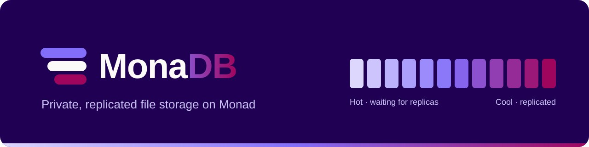

<p align="center">
  
</p>

# MonaDB

> **MonaDB** is private, replicated file storage built on [Monad](https://monad.xyz)
> (testnet chain ID `10143`, mainnet `143`). Files are compressed and encrypted
> in the user's browser and kept by replicator nodes that get paid for every
> copy they confirm. Monad holds the commitments, the payments and who may read
> each file. Files are stored as **blobs** by default: Reed-Solomon shards
> spread over the nodes, one on-chain entry per blob however large it is,
> storage prepaid per epoch and checked with on-chain storage proofs. Small
> files can also go straight to the nodes as chunks (**direct**) or through
> Monad's event logs in segment transactions (**ledger**). While data waits
> for its replicas it is **Hot**; once enough nodes hold it, it is **Cool**.
>
> MonaDB is the Monad sibling of [SolaDB](https://github.com/Emanuel250YT/SolaDB):
> same file format, blob protocol and features, rebuilt for the EVM.

| Component | Purpose |
| --- | --- |
| `contracts/` | One Solidity contract, `MonaDB` (34.7 KB; Monad allows 128 KB), built from four modules: **identity** + config + replicator registry (`MonaDBBase`), **chunks** (direct and ledger chunks, replication and its economics), **blobs** (erasure-coded shards, storage proofs, epochs) and **records** (sealed file manifests and per-reader grants). |
| `monadb-node` | NestJS replicator: receives blob shards and direct chunks over HTTP, rebuilds missing shards from the other nodes, rebuilds ledger chunks from their logs; checks everything against the on-chain hashes, stores it (filesystem, RocksDB or S3/R2/B2/SeaweedFS, metadata in Postgres, Oracle or a file), confirms on-chain, answers storage challenges and claims its rewards, serves data over HTTP. |
| `sdk/` (`@monadb/sdk`) | TypeScript SDK and `monadb` CLI on ethers v6: wallet-derived keys, gzip + end-to-end encryption, Reed-Solomon erasure coding and Merkle proofs, blob / direct / ledger uploads in one wallet transaction, bundles of small files, verified downloads, share, revoke, extend, reclaim escrow. |
| `app/` | Browser app: any EIP-6963 wallet (MetaMask, Rabby, Phantom, Backpack…) plus a test-only burner wallet on the local chain. |

## Deployments

| Network | Status | Details |
| --- | --- | --- |
| Monad testnet (10143) | Not deployed yet: needs a funded deployer (~1 MON covers the 7.7M-gas deployment at 100 gwei, plus MON to fund the replicators) | `deployments/monad-testnet.json` after `npm run deploy:testnet` |
| Monad mainnet (143) | Not deployed | `npm run deploy:mainnet` |

## How it works

```
 Browser / CLI (SDK)
  │  1. derive an X25519 key from a wallet signature (personal_sign) → registerIdentity
  │  2. gzip (when it saves ≥ 10 %), encrypt (AES-256-GCM, random key), erasure-code or split
  │  3. ONE wallet transaction: upload(chunks[], blobs[], writer, schema, sealed manifest)
  │       opens + pays every chunk / blob, creates the record, funds the session key (ledger)
  │  4a. blob (default):   PUT /blob/:id/shard/:i to n nodes, one shard each  ── 0 transactions
  │  4b. direct:           PUT /chunk/:id/data to up to `replicas` nodes       ── 0 transactions
  │  4c. ledger:           session key → writeSegment(id, i, bytes) × M         ── 48 KiB per tx, bytes in the logs
  ▼
MonaDB contract ── chunk: sha256, layout, replicas, escrow   blob: Merkle root, slots, escrow, epochs
  │                                 │
  │  fee: 10 % protocol,            ▼
  │  90 % escrowed per replica    Replicator nodes (monadb-node)
  │                                 │  find work with eth_call: pendingChunks / pendingBlobs (on-chain queues)
  │                                 │  direct / blob: bytes pushed by the uploader, or copied/rebuilt from peers
  │                                 │  ledger: eth_getLogs(SegmentWritten, chunk id) in 100-block windows
  │                                 │  verify sha256 / Merkle roots against the contract, store
  │                                 ▼
  │  confirmReplications(ids[]) / confirmShard ─ the reward moves from the escrow to the node
  ◄─────────────────────────────────┘
  │  ≥ 60 % of replicas confirmed → Cool;  last replica → the chunk entry is deleted
  │  blobs: challenges with a future block's hash → proveShard (1 KiB + Merkle path) → claimShardRewards
  ▼
 Reader: getRecord (or getGrant) → open the sealed manifest → fetch from the nodes → verify + decrypt + gunzip
         (ledger chunk and no node has it? the SDK rebuilds it from the logs)
 Share:  grantAccess(record, viewer, manifest sealed to the viewer's key)
 Delete: one multicall: deleteRecord (revokes every grant) + closeChunk × N (escrow back)
```

### Blobs: erasure-coded storage for large volumes

Specified in [docs/blob-protocol.md](docs/blob-protocol.md) (same format as SolaDB; §5 is the contract). A blob turns a payload into `k + m` shards with Reed-Solomon over GF(2^8): any `k` shards rebuild it, so it survives `m` lost nodes while storing only `(k + m) / k` times its size. The SDK picks the code from the nodes available (10+4 with 14 nodes, 4+2 with 6, 2+1 with 3).

- **One entry per blob.** `openBlob` stores a single Merkle root over the shard roots (leaves = 1 KiB segments). 1 TB is about 100 entries, not ~119 000 chunks.
- **Shards go straight to the nodes**, one per node, in resumable 8 MiB `PUT`s. Each node checks its shard against the root the uploader paid for, then takes its slot with `confirmShard`, which opens a challenge right away: a node that took a slot without the bytes loses it within the challenge window. Readers fetch fragments with their Merkle proof (`x-monadb-proof`), verify each one and decode from any `k` shards.
- **Storage is prepaid per epoch** (`pricePerMibEpoch`, default 0.001 MON per MiB of shard per 30 days) and escrowed for the blob. A holder's rewards unlock only up to its last **storage proof**: anyone can `createChallenge`, the segment to answer is picked by the hash of a block that does not exist yet (`blockhash(challengeBlock)`), and the holder must send that 1 KiB segment with its Merkle path in `proveShard` within `challengeWindowBlocks` (200 blocks ≈ 80 s on Monad). Nodes challenge themselves before claiming.
- **Lost shards are repaired.** A holder that lets a challenge expire loses its slot and unclaimed rewards (`failChallenge`, with a bounty for the reporter); any other node then rebuilds that shard from `k` others, fragment by fragment, and takes the slot.
- **Bundles** pack many small files into one blob and one record (`uploadFiles`).
- Owners `extendBlobs` before expiry; one epoch after expiry `closeBlob` returns the unspent escrow.

| 1 TB of data | Chunks (direct, 2 copies) | Blobs (10+4) |
| --- | --- | --- |
| On-chain entries / wallet transactions | ~119 000 / ~2 000 (60 chunks per transaction) | ~100 / ~3 (blobs of up to 10 GiB, files of up to ~200 GB) |
| Bytes stored on nodes | 2 TB, survives 1 lost copy | 1.4 TB, survives 4 lost nodes |
| Holders accountable | Paid once at confirmation | Paid per epoch against storage proofs |

### Direct and ledger chunks

- A chunk's bytes never live in contract storage. The chunk entry keeps only the commitment (sha256), the layout, the replicas that confirmed and the escrowed rewards.
- **Direct** (`segmentSize = 0`, up to 16 MiB): the chunk is `Hot` as soon as it is opened. The uploader sends the bytes to replicator nodes over HTTP; a node only stores bytes that hash to a chunk somebody paid for. Nodes that were not sent the chunk copy it from a node that has it. If no node took it, the uploader closes it after 10 minutes and gets everything but the fee back.
- **Ledger** (up to 4 MiB per chunk): each `writeSegment` carries one slice (≤ 96 KiB, SDK default 48 KiB) whose bytes live only in the `SegmentWritten` event. The contract accepts each index once, so every replicator rebuilds exactly the same bytes, and the last write turns the chunk from `Pending` to `Hot`. Readers can rebuild it from the logs before any node has it, and after the chunk entry is gone (from the record's `createdBlock`). Calldata costs ~40 gas per byte on Monad, so this path is for small files or when no node is up.
- Once `replicationThresholdPct` (60 %) of the requested replicas confirm, the chunk is **Cool**. Confirmations stay open until every requested replica exists; the last one deletes the entry.

### Economics

Each chunk costs `replicas × (baseFeePerReplica + ⌈size × pricePerMib / MiB⌉)` wei, paid in `upload` / `openChunk` (with a `maxFee` guard):

- `protocolFeeBps` (default 10 %) accrues to the treasury (`withdrawProtocolFees`, callable by anyone).
- The rest is escrowed per requested replica. `confirmReplication(s)` pays the node in the same transaction (no withdraw step). Nodes confirm up to 8 chunks per transaction.
- After `replicationWindow` (default 7 days) the uploader can `reclaimUnreplicated` the rewards of unfilled slots, or `closeChunk` to get them back and delete the entry. A `Pending` upload can be aborted at any time, a direct chunk nobody confirmed after 10 minutes.
- Unlike Solana there is no rent: storage on Monad is paid once, in gas, when it is written (17 100 gas per new storage slot), so records keep the manifest compact.

Default pricing (`scripts/lib/common.ts`, ≈ SolaDB's USD prices with MON at USD 0.02): 0.02 MON per replica (covers the node's confirmation gas) + 0.1 MON per MiB per replica, pro rata; blobs 0.001 MON per MiB of shard per 30-day epoch.

What a file costs, measured with `npm run measure-costs` (2 replicas, default pricing, incompressible data; gas priced at Monad's minimum base fee of 100 gwei, MON at USD 0.02; Hardhat applies Ethereum's gas schedule, so storage writes are ~20 % dearer than on Monad):

| File | Mode | Chunks | Segment txs | Upload fee | Gas | Total |
| --- | --- | --- | --- | --- | --- | --- |
| 100 KiB | direct | 1 | 0 | 0.0595 MON (USD 0.0012) | 0.57 M → 0.057 MON | 0.116 MON (USD 0.0023) |
| 100 KiB | ledger | 1 | 3 | 0.0595 MON | 4.6 M → 0.464 MON | 0.523 MON (USD 0.0105) |
| 1 MiB | direct | 1 | 0 | 0.240 MON (USD 0.0048) | 0.52 M → 0.052 MON | 0.292 MON (USD 0.0058) |
| 1 MiB | ledger | 1 | 22 | 0.240 MON | 42.8 M → 4.28 MON | 4.52 MON (USD 0.090) |
| 10 MiB | direct | 2 | 0 | 2.08 MON (USD 0.042) | 0.76 M → 0.076 MON | 2.16 MON (USD 0.043) |
| 10 MiB | ledger | 10 | 220 | 2.40 MON | 426 M → 42.6 MON | 45.0 MON (USD 0.90) |

Blobs: 12 epochs of 30 days prepaid, one `upload` transaction of ~0.52 M gas (≈ 0.052 MON, USD 0.001) whatever the size; the shards themselves cost no transaction:

| File | Erasure code | Stored on nodes | Storage fee (~1 year) |
| --- | --- | --- | --- |
| 1 MiB | 2+1 | 1.5 MiB | 0.079 MON (USD 0.0016) |
| 1 MiB | 10+4 | 1.4 MiB | 0.297 MON (USD 0.0059) |
| 100 MiB | 2+1 | 153 MiB | 1.90 MON (USD 0.038) |
| 100 MiB | 10+4 | 147 MiB | 2.04 MON (USD 0.041) |
| 1 GiB | 2+1 | 1 539 MiB | 18.5 MON (USD 0.37) |
| 1 GiB | 10+4 | 1 442 MiB | 17.6 MON (USD 0.35) |

| Operation | Gas (Hardhat) |
| --- | --- |
| `registerIdentity` | 68 k |
| `upload`: 1 direct chunk + record | 0.52–0.64 M |
| `upload`: 1 blob 10+4 + record | 0.52 M |
| `writeSegment` 48 KiB | 1.98 M (calldata) |
| `confirmReplication` / last one (deletes the entry) | 96 k / 110 k |
| `confirmReplications` × 8 | 512 k |
| `confirmShard` | 122 k |

### Privacy model

- Chunks and shards are AES-256-GCM ciphertext under a random per-file key. Event logs are public and permanent, so encryption is the protection.
- The file key and chunk / blob list (the manifest, a compact binary format) are sealed with X25519 + HKDF-SHA256 + AES-256-GCM to the owner's key and stored in a record. Each reader gets their own sealed copy in a grant.
- The X25519 key comes from the wallet's signature of a fixed message (wallets sign deterministically, RFC 6979), so there are no extra secrets to store. Only sign that message inside MonaDB apps.

## Monad specifics

| Topic | How MonaDB handles it |
| --- | --- |
| Gas is charged on the **gas limit** | Every transaction (SDK, node, scripts) carries an explicit limit: `eth_estimateGas` + 10 %. A call that would revert fails at estimation and costs nothing. Ledger segments are sent in two waves (all but each chunk's last, then the last ones) so the completing write is estimated with its extra work. |
| No `eth_newFilter` | Nothing uses filters (the provider refuses them). The work queues live on-chain (`pendingChunks`, `pendingBlobs`, read with `eth_call`); ledger bytes are read with `eth_getLogs` in 100-block windows (halved if the RPC rejects a range). Monad full nodes serve the whole log history. |
| 10 MON reserve balance | An account under 10 MON can only send value (an upload fee) in a transaction that is its first in 3 blocks. The SDK waits for that window before value-carrying transactions when the balance is low; the session key waits 4 quiet blocks before sweeping its leftover back. |
| Calldata ~40 gas per byte | Blob and direct uploads keep bytes off-chain (one transaction per file); the ledger path is the fallback. |
| 400 ms blocks, 1 s timestamps | Challenges are counted in blocks (`challengeWindowBlocks`, default 200 ≈ 80 s); rewards and epochs in seconds. |
| `BLOCKHASH` reaches 256 blocks | `challengeWindowBlocks ≤ 240`. An `eth_call` at the latest block cannot read that block's hash, so `challengeSegment` answers one block after the challenge block exists. |
| 128 KB contracts | One contract (34.7 KB), like SolaDB's single program. |
| Storage pages (17 100 gas per new slot) | Records hold a compact binary manifest; chunk and blob entries are packed into a few slots; files with more than 16 chunks keep their chunk list in an encrypted index chunk. |
| One wallet prompt | `upload` opens every chunk and blob and creates the record in one transaction; `multicall` batches deletes and closes; `extendBlobs` extends a whole file. |

## Getting started

Prerequisites: Node.js ≥ 22. Everything runs natively (Windows, macOS, Linux); Docker only for the node's Postgres / S3 stack.

```sh
npm install                 # contracts + sdk + app workspaces
npx hardhat compile
npx hardhat test            # 47 contract tests
npm run build:sdk
```

### Local rehearsal (everything on your machine)

```sh
npm run localnet            # terminal 1: Hardhat node, chain 31337, a block every second
npm run deploy:localnet     # deploys, configures, registers 4 local replicators → deployments/monad-localnet.json
npm run test:sdk            # SDK unit tests + end-to-end tests (each run deploys its own contract)
npm run measure-costs       # gas and cost per file size → deployments/costs-localnet.json
```

With the contract deployed, run four replicator nodes and the end-to-end checks:

```sh
(cd monadb-node && npm install && npm run build)
npm run nodes:localnet      # terminal 2: dev accounts #1–#4 as nodes on ports 3000–3003 (file stores)
npm run e2e:localnet        # ledger chunk → node confirmation → direct file → sharing, through node 3000
npx tsx monadb-node/test/e2e-localnet.ts   # the node's own checks: chunks on one node (own ports)
npx tsx monadb-node/test/e2e-blobs.ts      # blobs on four nodes: lost node, proofs + claims, failed challenge, repair, bundles
```

Localnet roles use Hardhat's well-known development accounts (never use them anywhere else): #0 admin + treasury, #1–#4 replicators on ports 3000–3003, #5–#9 test users.

### Deploy and configure

```sh
cp .env.example .env        # DEPLOYER_PRIVATE_KEY, REPLICATOR_ADDRESSES / _ENDPOINTS, pricing
npm run deploy:testnet      # deploy + init → deployments/monad-testnet.json
npm run fund-replicator:testnet
npm run export-abi          # refresh sdk/src/abi and sdk/src/deployments.ts
npm run verify:testnet      # MonadVision (Sourcify); Monadscan too with ETHERSCAN_API_KEY
```

`init.ts` is idempotent: it applies the pricing when it changed, registers replicators and rewrites the deployments file. Only the admin (the deployer) can change the config.

### Run a replicator node

With Docker: the node stores chunks and shards in SeaweedFS (an S3-compatible server) and metadata in Postgres; Oracle is still available with `--profile oracle`.

```sh
cp monadb-node/.env.example monadb-node/.env    # MONAD_RPC_URL, MONADB_CONTRACT, NODE_ENDPOINT, …
printf '0x…' > .keys/testnet-replicator.key     # the replicator's private key (gitignored)
docker compose up -d --build                    # node + SeaweedFS (S3) + postgres (dev passwords: override them)
```

Storage backends (`monadb-node/.env.example` lists every variable):

| What | Options |
| --- | --- |
| Chunks (`CHUNK_STORE`) | `s3` (AWS S3, Cloudflare R2, Backblaze B2, SeaweedFS, MinIO: `S3_BUCKET`, `S3_ENDPOINT`, …), `rocksdb`, `fs` |
| Blob shards (`BLOB_STORE`) | `s3` (multipart uploads, range reads; staging on local disk) or `fs` |
| Metadata (`METADATA_STORE`) | `postgres` (`DATABASE_URL`, `PG_SCHEMA`), `oracle`, `file` |

Without Docker (file stores, for development):

```sh
npm run build:sdk
cd monadb-node && npm install && npm run build
MONADB_DEPLOYMENT=../deployments/monad-localnet.json CHUNK_STORE=fs METADATA_STORE=file BLOB_STORE=fs \
  REPLICATOR_PRIVATE_KEY=0x… PORT=3000 NODE_ENDPOINT=http://localhost:3000 npm run start:prod
```

Replicator settings worth knowing: `MIN_REWARD_WEI` (skip cheap chunks), `BLOB_CLAIM_MIN_WEI` (default 0.05 MON: a self-challenge, its proof and the claim cost ~0.03 MON at 100 gwei, so smaller claims would lose money; expired blobs are claimed whatever the amount), `BLOB_REPAIR` (rebuild vacant slots), `BLOB_CHALLENGE_OTHERS` (challenge other holders for the bounty), `LOGS_BLOCK_RANGE` (eth_getLogs window), `UPDATE_ENDPOINT_ON_START` (publish `NODE_ENDPOINT` on-chain).

The node exposes:

- `GET  /status`: network, contract, replicator registration, balance, confirmations, earnings, last scan
- `POST /query`: JSON query language (filter, sort, paginate) over stored chunks
- `GET  /chunk/:id/meta`, `GET /chunk/:id/data`: chunk metadata and raw (encrypted) bytes; CORS enabled
- `PUT  /chunk/:id/data`: a direct chunk from its uploader (≤ 16 MiB); stored and confirmed only if it matches the on-chain chunk
- `PUT  /blob/:blob/shard/:index?offset=N`: a piece of a blob shard (resumable; the first piece carries the shard roots and fragment size); verified against the on-chain root, then `confirmShard`
- `GET  /blob/:blob/roots`, `GET /blob/:blob/info`: the shard roots and layout
- `GET  /blob/:blob/shard/:index/fragment/:stripe`: one fragment, with its Merkle proof in `x-monadb-proof`
- `GET  /blob/status`: shards held, pushes, rebuilds, proofs, claims, challenges
- `GET  /docs`: Swagger/OpenAPI UI

### SDK

```ts
import { BrowserProvider } from 'ethers';
import { MonaDBClient, DEPLOYMENTS } from '@monadb/sdk';

const signer = await new BrowserProvider(window.ethereum).getSigner();   // or an ethers Wallet
const monadb = new MonaDBClient({ signer, deployment: DEPLOYMENTS.testnet });
await monadb.register();                                                 // one signature + one tx
const quote = await monadb.quoteFile(bytes.length, 2, 'auto', { name: 'video.mp4' }); // fee + gas, in wei
const { recordId } = await monadb.uploadFile(bytes, { name: 'video.mp4', epochs: 12 }); // blob when nodes answer
await monadb.uploadFile(bytes, { name: 'audit.pdf', mode: 'ledger' });   // through Monad's logs instead
const bundle = await monadb.uploadFiles(invoices, { name: 'facturas-octubre' }); // N small files, 1 blob
await monadb.downloadFile(bundle.recordId, { entry: 'factura-7.json' });
await monadb.extendFile(recordId, 12);                                   // prepay 12 more epochs, one tx
await monadb.share(recordId, friendAddress);                             // friend must be registered
await monadb.lookupFile(recordId);                                       // a link's file: ok | no-access (+ owner) | missing
const { data } = await monadb.downloadFile(recordId);                    // verified + decrypted
await monadb.reclaimAllDeposits();                                       // unfilled / aborted chunks, expired blobs
```

### CLI

```sh
npm run build:sdk
export MONADB_NETWORK=testnet MONADB_PRIVATE_KEY=0x…
node sdk/dist/cli.js register
node sdk/dist/cli.js quote ./video.mp4 --epochs 12                   # --mode blob|direct|ledger|auto
node sdk/dist/cli.js upload ./video.mp4 --epochs 12 --redundancy 4    # --mode ledger, --no-compress
node sdk/dist/cli.js upload-many facturas ./facturas/*.json           # one bundle, one blob
node sdk/dist/cli.js bundle <recordId> -d ./restored
node sdk/dist/cli.js extend <recordId> 12
node sdk/dist/cli.js ls
node sdk/dist/cli.js share <recordId> <address>
node sdk/dist/cli.js download <recordId> -o copy.pdf
node sdk/dist/cli.js reclaim
```

On localnet use `MONADB_DEPLOYMENT=deployments/monad-localnet.json` (the SDK's built-in `DEPLOYMENTS` only lists public networks).

### App

```sh
npm run app:dev        # http://localhost:5173, Monad testnet by default
```

For the local chain set `VITE_MONADB_NETWORK=localnet` and `VITE_MONADB_DEPLOYMENT` (see `app/.env.example`), and use the burner wallet (test only) with its Fund button.

## Repository layout

```
contracts/
  MonaDB.sol                    the deployed contract: modules + upload() + multicall
  core/MonaDBBase.sol           config, admin, identities, replicator registry, fees
  core/ChunkStorage.sol         openChunk, writeSegment, confirmReplication(s), reclaim, close, pendingChunks
  core/BlobStorage.sol          openBlob, confirmShard, challenges, proveShard, claims, extend, close, pendingBlobs
  core/RecordStore.sol          sealed manifests, grants
  libraries/BlobMerkle.sol      sha256 Merkle proofs and the challenged segment
  MonaDBTypes.sol, IMonaDBEvents.sol
test/                           Hardhat tests (contracts, using the SDK's Merkle helpers)
sdk/                            @monadb/sdk + monadb CLI: contract.ts (ABI, ids, decoders), erasure.ts, merkle.ts, blob-layout.ts, client.ts (+ tests)
app/                            browser app (Vite)
monadb-node/                    NestJS replicator node: replicator/ (chunks), blobs/ (shards, proofs, repair), storage/ (fs, RocksDB, S3, Postgres, Oracle)
scripts/                        deploy, init, fund-replicator, e2e, measure-costs, export-abi, verify
deployments/                    deployed addresses, e2e results, measured costs
docs/blob-protocol.md           the blob format and protocol (normative)
docker-compose.yml              replicator + SeaweedFS (S3) + Postgres (Oracle profile)
```

After changing a contract, run `npx hardhat compile` and `npm run export-abi`.

## Origins

MonaDB comes from [AvaDB](https://github.com/Emanuel250YT/AvaDB) (Avalanche, then a first Monad port) and from [SolaDB](https://github.com/Emanuel250YT/SolaDB), whose features it brings back to the EVM:

| SolaDB on Solana | MonaDB on Monad |
| --- | --- |
| 1 Anchor program, PDAs per identity / chunk / blob / record / grant | 1 contract, mappings keyed by `keccak256("chunk" \| "blob" \| "record", owner, …)` |
| Ledger segments in `write_segment` instruction data (3 864 bytes per v1 tx) | Ledger segments in `SegmentWritten` events (48 KiB per tx) |
| Work queue: `getProgramAccounts` with a memcmp | Work queue: on-chain sets read with `eth_call` (`pendingChunks`, `pendingBlobs`) |
| Challenge randomness: SlotHashes (skipped slots, voided windows) | Challenge randomness: `blockhash(challengeBlock)` (every block is produced) |
| Rent locked per account, refunded on close | No rent: storage paid once in gas; escrow refunded on close |
| One wallet batch of instructions | One `upload` transaction; `multicall` for owner batches |
| Key from an ed25519 message signature | Key from a secp256k1 `personal_sign` signature |
| Protocol share transferred to the treasury on each upload | Protocol share accrues; `withdrawProtocolFees` |

## License

[MIT](LICENSE)
